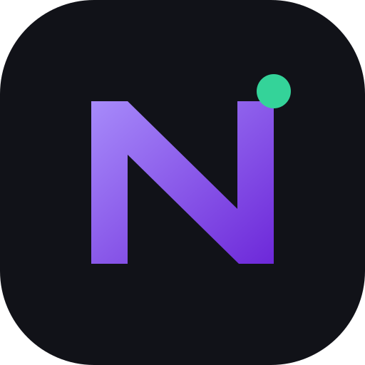
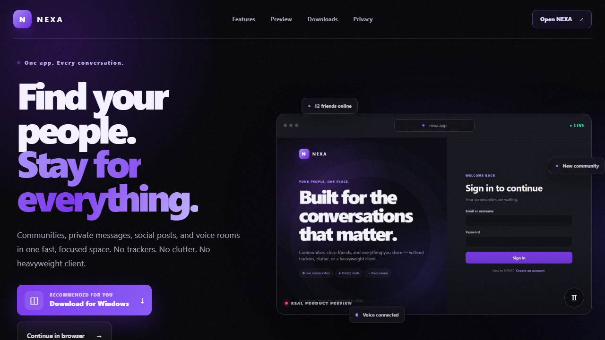
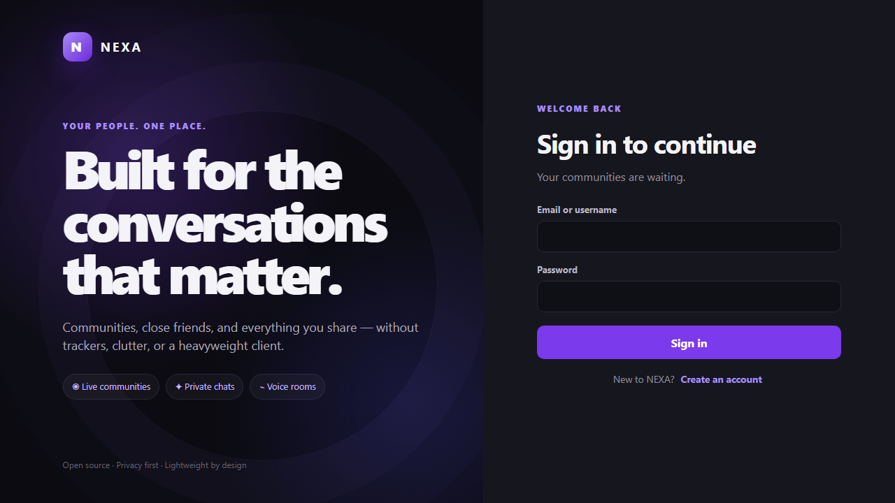
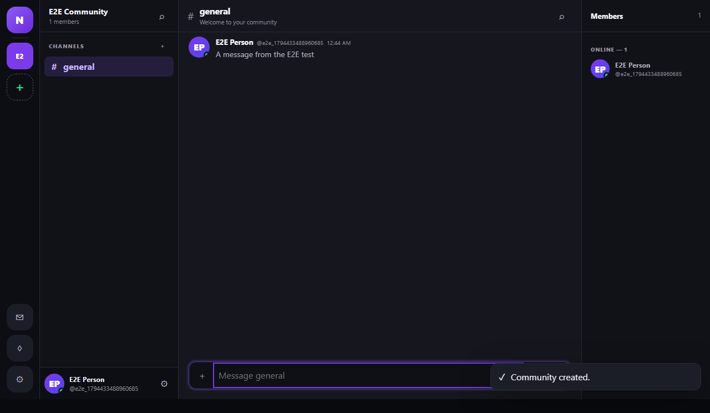

<div align="center">
  
  <h1>NEXA</h1>
  <p><strong>Lightweight communities, social posts, private chat, and small voice rooms.</strong></p>
  <p>
    <a href="docs/BUILDING.md">Setup</a> ·
    <a href="docs/ARCHITECTURE.md">Architecture</a> ·
    <a href="docs/API.md">API</a> ·
    <a href="docs/SECURITY.md">Security</a> ·
    <a href="docs/TEST_REPORT.md">Test report</a>
  </p>
</div>

NEXA is an MIT-licensed, Discord-first community platform with a social feed and direct messaging.
One Svelte codebase ships as a static PWA, a Capacitor Android app, and a low-overhead Tauri Windows
app. The API runs on Cloudflare Workers, Durable Objects, D1, and R2.

<p align="center">
  
  
  
</p>

## What works

- Secure registration/login, age gate, HIBP password screening, email verification/reset APIs,
  rotating refresh sessions with reuse detection, TOTP 2FA, device/session revocation, export/delete.
- Profiles, privacy controls, follows/friends/blocks/reports, feed, posts, uploads, likes, nested
  comments, shares, search, notifications, and an administrator report queue.
- DMs and group conversations; realtime channel/DM messages; edit/delete/reply/forward, reactions,
  threads, search, attachments, Opus voice notes, receipts, typing, presence, and unread counts.
- Communities, categories, text/voice/announcement channels, role bitmasks, channel overwrites,
  invites, pins, audit log, slow mode, configurable automod, kick/ban/mute, and member lists.
- Hibernatable Durable Object WebSockets and WebRTC audio mesh rooms capped at six peers.
- Dark/light themes, low-power mode, installable/offline shell, keyboard shortcuts, English/Arabic
  RTL, responsive layouts, semantic labels, focus styles, and virtualized chat rows.
- Metadata-stripped, magic-byte-checked uploads; Cloudflare R2 authorization checks; Android FCM;
  strict Worker/Pages/Tauri/Android security configuration.

## Repository

```text
apps/web/          SvelteKit static PWA — the only UI source
apps/android/      Capacitor wrapper and generated Gradle project
apps/desktop/      Tauri 2 Rust wrapper and Windows bundler config
packages/shared/   schemas, domain types, permissions, constants
backend/           Workers API, Durable Object, D1 migrations, R2 media
tests/             Playwright E2E, bundle budget, and k6 load scripts
docs/              setup, architecture, security, operations, reports
.github/workflows/ pinned CI, deploy, and native release workflows
```

The product name is changed in one source constant: `packages/shared/src/constants.ts` →
`APP_NAME`. Native package labels and identifiers are deployment metadata and should be updated
when doing a full rebrand.

## Local quick start

Prerequisites: Node.js 22.12+ and Git. Java 21 is needed only for APK builds; Rust 1.90+ and the
Windows WebView2/WiX prerequisites are needed only for desktop builds.

```bash
npm install
copy backend\.dev.vars.example backend\.dev.vars
npm run db:migrate:local --workspace=@nexa/backend
npm run dev:api
```

In a second terminal:

```bash
npm run dev:web
```

Open <http://localhost:5173> for the public download site, or <http://localhost:5173/app> to launch
NEXA directly in the browser. Replace every value in `backend/.dev.vars`; the example values are not
safe. Full beginner deployment and signing instructions are in [`docs/BUILDING.md`](docs/BUILDING.md).

## Quality gates

```bash
npm run check
npm test
npm run test:coverage
npm run build
npm run bundle:budget
npm audit --audit-level=high
npm run test:e2e
```

Latest results from this environment are in [`docs/TEST_REPORT.md`](docs/TEST_REPORT.md), including
passing Chromium, Firefox, WebKit, mobile viewport, and axe runs. No APK, Windows installer, device
RAM, one-hour leak, or Lighthouse number is claimed until it is measured by the documented
CI/device procedure.

## Important limitations

- DMs are protected by TLS and authorization but **are not end-to-end encrypted**. E2EE requires an
  audited multi-device protocol and is intentionally a roadmap item rather than fake encryption.
- Browser Web Push subscription storage is implemented; production Web Push payload delivery still
  needs a standards-compliant VAPID encryption sender. Android FCM delivery is implemented.
- P2P voice works best for two to six users and can fail behind restrictive NAT without TURN.
  Cloudflare Realtime TURN/SFU is the documented free-tier upgrade path.
- Free tiers have hard daily limits and no SLA. NEXA returns errors rather than silently creating a
  bill. See [`docs/FREE_TIER.md`](docs/FREE_TIER.md).
- Windows SmartScreen reputation normally requires a paid trusted code-signing certificate. Tauri
  updater artifacts can be cryptographically signed for free, but that does not create SmartScreen
  reputation.

## License

[MIT](LICENSE) © 2026 NEXA contributors.
