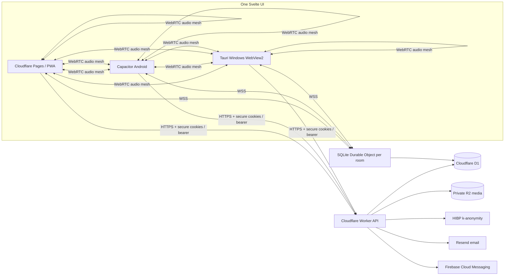

# Architecture

## System view

## Design choices

- **Static SvelteKit:** no application SSR process, a small startup graph, route/code splitting, and
  identical UI behavior in browsers and WebViews.
- **Worker + D1:** relational constraints and indexed cursor queries keep authorization explicit.
- **One hibernatable Durable Object per room:** ordering, presence, typing, signaling, and fan-out
  without polling. Every event re-checks the D1 session and room membership.
- **R2 private by default:** random object keys are not considered authorization. `/v1/media/*`
  checks profile/post visibility, ownership, or message-room membership before reading R2.
- **P2P voice:** avoids a permanently running media server for rooms up to six. TURN/SFU is an
  optional deployment upgrade.
- **Cookie-first auth:** WebViews use the system-protected cookie jar; JavaScript never persists
  access or refresh tokens. A bearer path exists for future native secure-storage clients.

## Request flow

1. Global middleware assigns a request ID, validates Origin/CORS, and appends security headers.
2. `authenticate` validates JWT signature/issuer/type/expiry and verifies its session is active.
3. Cookie mutations also validate a double-submit CSRF value bound by hash to that session.
4. Valibot parses bounded inputs; route/service authorization checks the resource relationship.
5. D1 statements are parameterized. Multi-row invariants use `D1.batch()` where possible.
6. Realtime changes are broadcast through the room Durable Object; clients deduplicate by ID and
   `clientNonce`.

## Performance controls

- Conservative landing + browser-app entry graph: **66.5 KiB gzip**; CI fails above 150 KiB.
- Voice and native-push modules are dynamic imports.
- Cursor pagination caps normal reads at 100 rows; chat uses measured-height windowing.
- Static image decoding is lazy; uploads are re-encoded client-side to WebP at max 1600 px, then
  checked and stripped again server-side.
- No polling loop. Reconnect uses capped exponential backoff. Heartbeats and reconnect timers stop
  while hidden; low-power mode halves heartbeat frequency and disables animations.

## Failure boundaries

| Failure                  | Behavior                                                                             |
| ------------------------ | ------------------------------------------------------------------------------------ |
| D1 daily limit           | API returns a service error; no data is silently dropped                             |
| R2 unavailable           | upload/read fails; D1 row is rolled back on failed upload metadata insert            |
| Durable Object reconnect | client backs off; message nonces make retries idempotent                             |
| Email provider missing   | account works unverified; verification API returns accepted without leaking accounts |
| FCM missing              | in-app notifications remain; push delivery is skipped                                |
| Offline client           | app shell and opted-in recent GET responses remain readable; writes clearly fail     |

See [DATABASE.md](DATABASE.md), [REALTIME.md](REALTIME.md), and [SECURITY.md](SECURITY.md).
