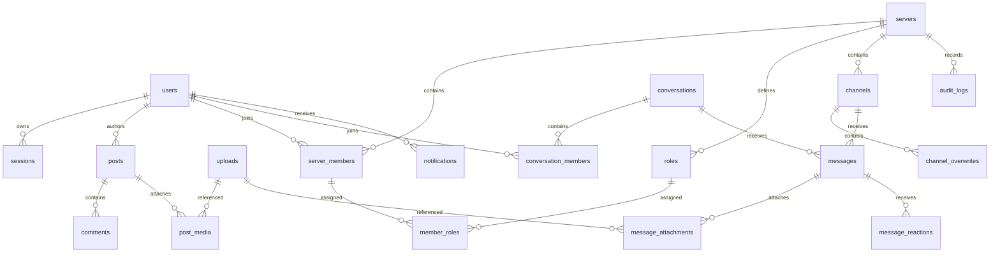

# Database schema

The executable source of truth is `backend/migrations/*.sql`. D1 foreign keys are enabled, IDs are
opaque UUID-prefixed strings, timestamps are UTC ISO-8601 text (session expiries are Unix seconds),
and high-volume lookups have composite indexes.

## Important invariants

- A message belongs to exactly one channel or conversation.
- `UNIQUE(author_id, client_nonce)` makes message retries idempotent.
- One `@everyone` role is allowed per server; owners are evaluated as administrators server-side.
- Refresh token hashes and one previous hash are unique. Seeing the previous token revokes every
  active session for that account.
- Deleting a user cascades authored relational data. Media objects are explicitly deleted before the
  user row because object storage is not relational.
- Soft-deleted messages preserve ordering/replies but lose content, attachments, and reactions.

## Search

The MVP uses bounded `LIKE` searches after authorization. At higher scale, move public discovery to
a dedicated index; never copy private message text into a third-party search provider without an
explicit privacy change and migration plan.
